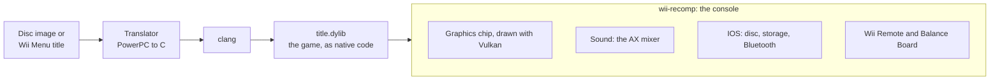

<div align="center">

# Wii Recomp

**The Wii console, rebuilt as native software.**

[](LICENSE)
[](#build-and-run)
[](recomp/README.md)

[What runs today](#what-runs-today) · [How it works](#how-it-works) · [Build and run](#build-and-run) · [Roadmap](ROADMAP.md)

</div>

Wii Recomp is the Wii rebuilt as native software. The goal is a small computer, such as a Raspberry Pi 5, that works as a Wii console: the Wii Menu starts up, you put in a disc, and the game plays on Wii Remotes and the Balance Board, all as native code with no emulator in between.

Every program the console runs, the Wii Menu and each game alike, is recompiled ahead of time. Its PowerPC code is translated to C and compiled with clang. The hardware around it is rebuilt as software: the graphics chip, sound, IOS, storage, Bluetooth and the controllers.

The same system runs on macOS, which is where most of it is developed, with other platforms to follow. [`ROADMAP.md`](ROADMAP.md) tracks the way to a complete console.

> [!IMPORTANT]
> This repository contains code only. Bring your own games. Disc images, extracted files, translated code, Wii storage and saves stay on your machine.

## What runs today

| Title | Where it stands |
| --- | --- |
| **Wii Fit Plus** (RFPE01) | Plays through setup and the Body Test with simulated controllers, at 60 fps on an Intel Mac. On a Raspberry Pi 5 at 1080p, the Body Test and the step-off screen hold 60 fps. |
| **Wii Menu 4.3** | Runs natively at 60 fps on an Intel Mac through the health warning, first-time setup, channel grid and settings. With a recompiled disc image in its drive, it shows the game's banner and starts it. |
| **The Last Story** (SLSEXJ) | Reaches gameplay with a simulated Wii Remote and Classic Controller, through the game's own Bluetooth code. Some surfaces draw wrong, and heavy scenes are slow. |

Real Wii Remotes and the Balance Board connect over Bluetooth on Linux and the Mac, and their reports go straight to the game's own code. That path is tested with stand-ins and hasn't met real hardware yet; see [Real Wii Remotes](recomp/README.md#real-wii-remotes-and-the-balance-board). When a game uses a hardware feature the runtime doesn't have, the runtime logs the feature by name. Each one is fixed once, for every game.

## How it works



1. **Find the code.** The translator follows branches and pointers from the program's entry point, so no symbols are needed. `--all-code` also sweeps for code that is reached only through tables built at run time.
2. **Find system functions by their contents.** The few system functions the runtime replaces are matched by hashes of their instructions, so a game needs no address list. If a match is unclear, the build stops instead of guessing.
3. **Write C.** Each PowerPC instruction becomes plain C, and clang does the optimizing. Any code the translator missed runs on a built-in PowerPC interpreter, and is logged so the next build translates it.
4. **Run.** The runtime models the hardware the game talks to: the graphics command stream and its timing, the Wii's colour stages as Vulkan shaders, the AX sound mixer, IOS for disc, storage and Bluetooth, and real or simulated Wii Remotes and Balance Board. The Wii's memory is one block at a fixed address, so a load or store in translated code is a few instructions.

The game's own code, its operating system and thread scheduler included, runs almost unchanged.

A build produces two files. `wii-recomp` is the console, the same program for every title. `title.dylib` (`title.so` on Linux) holds one game's translated code, and the console loads it.

## Build and run

You need `clang`, `ninja`, Python 3, GLFW, the Vulkan loader and shaderc.

<details>
<summary>Installing them</summary>

**macOS** (Xcode's command line tools provide clang):

```sh
brew install ninja glfw molten-vk vulkan-loader shaderc
```

Or install the LunarG Vulkan SDK and set `VULKAN_SDK` to its folder.

**Raspberry Pi OS:**

```sh
sudo apt install clang ninja-build python3 libglfw3-dev libvulkan-dev mesa-vulkan-drivers libshaderc-dev libasound2-dev
```

</details>

```sh
# Unpack your disc (ISO, RVZ or WBFS) into extracted/
python3 recomp/tools/extract_disc.py "path/to/game.rvz"

# Translate and compile it. A full build takes a few minutes.
python3 recomp/translate/emit.py extracted/sys/main.dol recomp/build/generated
python3 recomp/translate/build_file.py recomp/build
mkdir -p recomp/build/obj
(cd recomp/build && ninja)

# Play
recomp/build/wii-recomp extracted/sys path/to/Wii/NAND
```

The last argument is a Wii storage folder, such as Dolphin's NAND folder after its system update. Wii Recomp only reads it and writes saves to `recomp/build/saves`. Some games need the console settings it holds, such as SYSCONF, and won't start without one.

`extract_disc.py` uses [nodtool](https://github.com/encounter/nod), and downloads a pinned, checksummed copy if it isn't installed. For games that build their C++ method tables at run time, such as The Last Story, add `--all-code` to `emit.py`.

### Play from a disc image, or from the Wii Menu

```sh
# Pack the disc and its native code into one file
python3 recomp/tools/make_disc.py extracted game.wrd --native darwin-x86_64=recomp/build/title.dylib
recomp/build/wii-recomp game.wrd path/to/Wii/NAND

# Or set up a console with the Wii Menu, and put the disc in its drive
python3 recomp/tools/prepare_console.py path/to/Wii/NAND console --menu recomp/build-menu
cp game.wrd console/drive/ && recomp/build/wii-recomp --console console
```

[`recomp/README.md`](recomp/README.md) covers the controls, the settings, benchmarking, and a map of the source.

## Repository layout

| Folder | Contents |
| --- | --- |
| `recomp/translate` | The translator: finds code, matches system functions, writes C and the ninja file |
| `recomp/runtime` | The console: CPU state, hardware, graphics, sound, IOS, Bluetooth and the window |
| `recomp/tools` | Disc extraction, disc images, console setup, frame replay and benchmarks |
| `test` | Unit, translator and graphics tests, all on made-up data |
| `docs` | The hardware inventory and the native IOS plan |

## Tests

```sh
python3 -m unittest discover test
```

The tests need no Nintendo files. Set `VULKAN_SDK` to a folder with the Vulkan libraries to also run the graphics replay tests, which draw scenes without a window and compare pixels. Translator tests that need a game are skipped when `extracted/` is missing.

## Documents

- [`ROADMAP.md`](ROADMAP.md): the stages towards a complete native Wii, as checklists.
- [`docs/hardware_inventory.md`](docs/hardware_inventory.md): every part of the console, marked done, partial or missing.
- [`docs/native_ios.md`](docs/native_ios.md): how the native IOS runs the Wii Menu, and what comes next.

## Credits

Wii Recomp stands on years of other people's work on the Wii.

- [Dolphin](https://dolphin-emu.org/) is the reference for how the hardware behaves. The graphics, IOS, Bluetooth and real Wii Remote code follow its behaviour, and every part taken from it is listed, file by file, in [`CREDITS.md`](CREDITS.md).
- [WiiCompiled](https://github.com/patchzyy/Wiicompiled) showed two designs we built our own versions of: real Wii Remotes passed straight to a game's own code, and guest memory at a fixed address. None of its code is used.
- [nod](https://github.com/encounter/nod) reads disc images for `extract_disc.py`.
- [WiiBrew](https://wiibrew.org), YAGCD, and Hector Martin and others documented the console, the Wii Remote and its attachments.

## Legal

Wii Recomp is licensed under the GNU General Public License, version 2 or later. See [`LICENSE`](LICENSE).

The repository holds no Nintendo code, data or assets: no disc images, system software, keys, saves, or code translated from a game. Everything a game needs comes from a disc you own and a Wii storage folder you made, and it's translated and compiled on your own machine. The translated output stays there. Don't share it, and don't ask for games here.

Wii Recomp isn't affiliated with or endorsed by Nintendo. Wii, Wii Remote, Balance Board and Wii Fit are trademarks of Nintendo. Other names belong to their owners.
