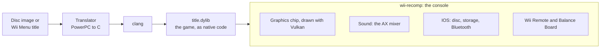

<div align="center">

# Wii Recomp

**The Wii console, rebuilt as native software.**

[](LICENSE)
[](#build-and-run)
[](recomp/README.md)

[What runs today](#what-runs-today) · [How it works](#how-it-works) · [Build and run](#build-and-run) · [Roadmap](ROADMAP.md)

</div>

Wii Recomp is the Wii rebuilt as native software. The goal is a small computer, such as a Raspberry Pi 5, that works as a Wii console: the Wii Menu starts up, you put in a disc, and the game plays on Wii Remotes and the Balance Board, all as native code with no emulator in between.

Every program the console runs, the Wii Menu and each game alike, is recompiled ahead of time. Its PowerPC code is translated to C and compiled with clang. The hardware around it is rebuilt as software: the graphics chip, sound, IOS, storage, Bluetooth and the controllers.

The same system runs on macOS, which is where most of it is developed, with other platforms to follow. [`ROADMAP.md`](ROADMAP.md) tracks the way to a complete console.

> [!IMPORTANT]
> This repository contains code only. Bring your own games. Disc images, extracted files, translated code, Wii storage and saves stay on your machine.

## What runs today

| Title | Where it stands |
| --- | --- |
| **Wii Fit Plus** (RFPE01) | Plays through setup and the Body Test with simulated controllers, at 60 fps on an Intel Mac. On a Raspberry Pi 5 at 1080p, the Body Test and the step-off screen hold 60 fps. |
| **Wii Menu 4.3** | Runs natively at 60 fps on an Intel Mac through the health warning, first-time setup, channel grid and settings. With a recompiled disc image in its drive, it shows the game's banner and starts it. |
| **The Last Story** (SLSEXJ) | Reaches gameplay with a simulated Wii Remote and Classic Controller, through the game's own Bluetooth code. Some surfaces draw wrong, and heavy scenes are slow. |

Real Wii Remotes and the Balance Board connect over Bluetooth on Linux and the Mac, and their reports go straight to the game's own code. That path is tested with stand-ins and hasn't met real hardware yet; see [Real Wii Remotes](recomp/README.md#real-wii-remotes-and-the-balance-board). When a game uses a hardware feature the runtime doesn't have, the runtime logs the feature by name. Each one is fixed once, for every game.

## How it works



1. **Find the code.** The translator follows branches and pointers from the program's entry point, so no symbols are needed. `--all-code` also sweeps for code that is reached only through tables built at run time.
2. **Find system functions by their contents.** The few system functions the runtime replaces are matched by hashes of their instructions, so a game needs no address list. If a match is unclear, the build stops instead of guessing.
3. **Write C.** Each PowerPC instruction becomes plain C, and clang does the optimizing. Any code the translator missed runs on a built-in PowerPC interpreter, and is logged so the next build translates it.
4. **Run.** The runtime models the hardware the game talks to: the graphics command stream and its timing, the Wii's colour stages as Vulkan shaders, the AX sound mixer, IOS for disc, storage and Bluetooth, and real or simulated Wii Remotes and Balance Board. The Wii's memory is one block at a fixed address, so a load or store in translated code is a few instructions.

The game's own code, its operating system and thread scheduler included, runs almost unchanged.

A build produces two files. `wii-recomp` is the console, the same program for every title. `title.dylib` (`title.so` on Linux) holds one game's translated code, and the console loads it.

## Build and run

Wii Recomp doesn't ship games or Nintendo's software. You bring your own, and everything is translated and compiled on your own computer:

- **A computer:** a Mac (developed on an Intel Mac) or a Raspberry Pi 5 with Raspberry Pi OS.
- **Your Wii's storage:** a NAND backup from your own Wii, which holds the Wii Menu and the console's settings.
- **Your game discs,** as ISO, RVZ or WBFS files you made from them.

You can play a game **directly**, which starts one game in a window and is the quickest way to try it, or **from the Wii Menu**, which works like a console: the menu starts, you put a disc in its drive, and you start the game from the Disc Channel.

### 1. Install the tools

You need `clang`, `ninja`, Python 3, GLFW, the Vulkan loader and shaderc.

```sh
# macOS (Xcode's command line tools provide clang)
brew install ninja glfw molten-vk vulkan-loader shaderc

# Raspberry Pi OS
sudo apt install clang ninja-build python3 libglfw3-dev libvulkan-dev mesa-vulkan-drivers libshaderc-dev libasound2-dev
```

On a Mac you can install the LunarG Vulkan SDK instead, and set `VULKAN_SDK` to its folder. `import_nand.py` also needs Python's `cryptography` package (`python3 -m pip install cryptography`).

### 2. Add your Wii's storage

Make a backup on your Wii with BootMii (Backup NAND). Copy `nand.bin` into this repository's `wii/` folder, with `keys.bin` beside it if BootMii saved the keys as a separate file, then decrypt it once:

```sh
python3 recomp/tools/import_nand.py
```

This makes `wii/nand/`, the storage every run reads. A Wii storage folder that's already decrypted works too: copy Dolphin's NAND folder, after its system update, into `wii/nand/`. [`wii/README.md`](wii/README.md) has the details. Everything in `wii/` except that README is ignored by git. The backup and keys belong to one console and hold its owner's data, so they never go in the repository.

### 3. Add a game

One command turns a disc image into a game the console plays:

```sh
python3 recomp/tools/add_game.py "path/to/game.rvz"
recomp/build/wii-recomp games/RFPE01.wrd
```

`add_game.py` extracts the disc, translates all of its code, builds the console if it isn't built yet, compiles the game and packs it as `games/<game ID>.wrd`. It also takes an extracted disc folder. The game's own Wii Remote code runs, against a simulated remote with a Classic Controller plugged in; Wii Fit Plus hides its pointer when it sees one, so play it with `WII_RECOMP_ATTACHMENT=none`. On a Raspberry Pi 5, Wii Fit Plus goes from an extracted disc to a playable image in under a minute and a half, where compiling it all for speed takes over seven minutes.

The first build compiles everything quickly, and the game counts how often each part of it runs while you play. Run the same command again, or `add_game.py RFPE01` with the game's ID, and the parts that did the work are compiled for speed. Only those files are compiled again, and the image's native code is swapped without copying the disc. Counts from every run add up, so the build keeps up with what you play. Each game builds in `recomp/build-<game ID>/`, and any code that had to run on the interpreter is translated by the next build.

#### Step by step

The same, one step at a time, for a single game built beside the console:

```sh
# Unpack the disc into extracted/
python3 recomp/tools/extract_disc.py "path/to/game.rvz"

# Translate its code to C and compile it. A full build takes a few minutes.
python3 recomp/translate/emit.py extracted/sys/main.dol recomp/build/generated
python3 recomp/translate/build_file.py recomp/build
mkdir -p recomp/build/obj && (cd recomp/build && ninja)

# Play
recomp/build/wii-recomp extracted/sys
```

The build makes `wii-recomp`, the console, which is the same program for every game, and `title.dylib` (`title.so` on Linux), the game's translated code. Saves go to `recomp/build/saves`; your Wii's storage is only read. The keyboard and mouse stand in for the Wii Remote: Enter is A, the arrows are the D-pad, the mouse points, and Space steps on the Balance Board. [`recomp/README.md`](recomp/README.md) lists every key and setting.

`extract_disc.py` uses [nodtool](https://github.com/encounter/nod), and downloads a pinned, checksummed copy if it isn't installed. For games that build their C++ method tables at run time, such as The Last Story, add `--all-code` to `emit.py`; `add_game.py` always does. `--profile` builds in the two tiers described above.

### 4. Play from the Wii Menu

The Wii Menu is a program too, so it's translated and compiled once, like a game. Games for the menu are built with `--virtual-bluetooth`: their own Wii Remote code then talks to the console's Bluetooth, as on a Wii, and that's also what real Wii Remotes need.

```sh
# Build the Wii Menu from your Wii's storage (once)
python3 recomp/translate/prepare_title.py wii/nand 00000001 00000002 recomp/build-menu/disc
python3 recomp/translate/emit.py recomp/build-menu/disc/sys/main.dol recomp/build-menu/generated --virtual-bluetooth
python3 recomp/translate/build_file.py recomp/build-menu vulkan
mkdir -p recomp/build-menu/obj && (cd recomp/build-menu && ninja)

# Set up a console: its own copy of your storage, the menu, and an empty drive
python3 recomp/tools/prepare_console.py wii/nand console --menu recomp/build-menu

# Add the game and put it in the console's drive, then turn the console on
python3 recomp/tools/add_game.py "path/to/game.rvz" --console console
recomp/build/wii-recomp --console console
```

`add_game.py` builds every game with `--virtual-bluetooth`, so the same image plays directly and from the menu. With `--console` it also reads the counts from games started from that console's menu, and moves any other disc in the drive to the console's `shelf/` folder.

A **`.wrd` disc image** is a game prepared for the console: the disc's files, unencrypted, plus the game's translated code for each computer it was built for (`darwin-x86_64` on an Intel Mac, `linux-aarch64` on a Pi). The console reads it like a disc in its drive. It holds the game, so it's yours alone: don't share it.

The menu shows the game's banner in the Disc Channel, and Start runs it. The simulated Wii Remote has a Classic Controller plugged in, and a game that sees one may hide its pointer. Wii Fit Plus is one, so start the console with `WII_RECOMP_ATTACHMENT=none` for it. The console stays a single program: when you start a game, it restarts itself with the game's code, as a Wii does.

### What doesn't work yet

- **A plain ISO in the drive.** Each game goes through `add_game.py` first.
- **Going back to the Wii Menu.** Home, then Wii Menu, freezes. Close the window instead.
- **The simulated board in a game's own setup.** With the game's own Wii Remote code, as `add_game.py` builds it, Wii Fit Plus's first-time setup gets to the Balance Board and then drops the simulated board, asking for its power button again. A build without `--virtual-bluetooth` gets through.
- **Real Wii Remotes and the Balance Board** are built but haven't been tried with real hardware. Until then the keyboard and mouse drive a simulated remote and board. See [Real Wii Remotes](recomp/README.md#real-wii-remotes-and-the-balance-board).
- **Playing from the Wii Menu** has been tested on an Intel Mac only. On a Raspberry Pi 5, games have been played directly.

## Repository layout

| Folder | Contents |
| --- | --- |
| `recomp/translate` | The translator: finds code, matches system functions, writes C and the ninja file |
| `recomp/runtime` | The console: CPU state, hardware, graphics, sound, IOS, Bluetooth and the window |
| `recomp/tools` | Disc extraction, NAND import, disc images, console setup, automatic play (`autoplay/`), frame replay and benchmarks |
| `test` | Unit, translator and graphics tests, all on made-up data |
| `docs` | The hardware inventory and the native IOS plan |
| `wii` | Your Wii's NAND backup, keys and decrypted storage. Ignored by git except its README |

## Tests

```sh
python3 -m unittest discover test
```

The tests need no Nintendo files. Set `VULKAN_SDK` to a folder with the Vulkan libraries to also run the graphics replay tests, which draw scenes without a window and compare pixels. Translator tests that need a game are skipped when `extracted/` is missing.

## Documents

- [`ROADMAP.md`](ROADMAP.md): the stages towards a complete native Wii, as checklists.
- [`docs/hardware_inventory.md`](docs/hardware_inventory.md): every part of the console, marked done, partial or missing.
- [`docs/native_ios.md`](docs/native_ios.md): how the native IOS runs the Wii Menu, and what comes next.

## Credits

Wii Recomp stands on years of other people's work on the Wii.

- [Dolphin](https://dolphin-emu.org/) is the reference for how the hardware behaves. The graphics, IOS, Bluetooth and real Wii Remote code follow its behaviour, and every part taken from it is listed, file by file, in [`CREDITS.md`](CREDITS.md).
- [WiiCompiled](https://github.com/patchzyy/Wiicompiled) showed two designs we built our own versions of: real Wii Remotes passed straight to a game's own code, and guest memory at a fixed address. None of its code is used.
- [nod](https://github.com/encounter/nod) reads disc images for `extract_disc.py`.
- [WiiBrew](https://wiibrew.org), YAGCD, and Hector Martin and others documented the console, the Wii Remote and its attachments.

## Legal

Wii Recomp is licensed under the GNU General Public License, version 2 or later. See [`LICENSE`](LICENSE).

The repository holds no Nintendo code, data or assets: no disc images, system software, keys, saves, or code translated from a game. Everything a game needs comes from a disc you own and a NAND backup and keys from your own Wii, and it's translated and compiled on your own machine. `.gitignore` keeps `wii/`, disc images and extracted files out of the repository. The translated output stays there. Don't share it, and don't ask for games here.

Wii Recomp isn't affiliated with or endorsed by Nintendo. Wii, Wii Remote, Balance Board and Wii Fit are trademarks of Nintendo. Other names belong to their owners.
